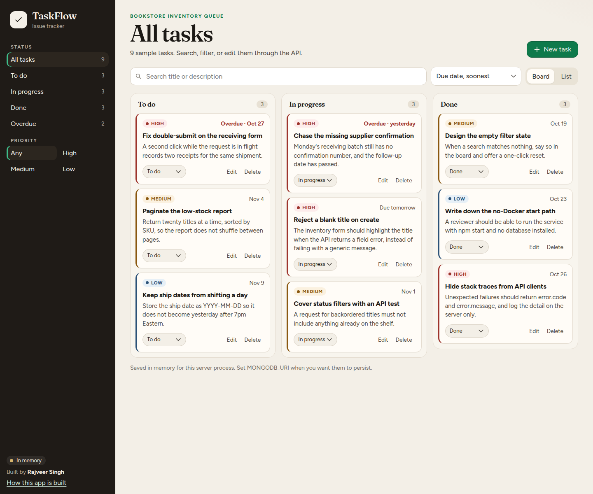
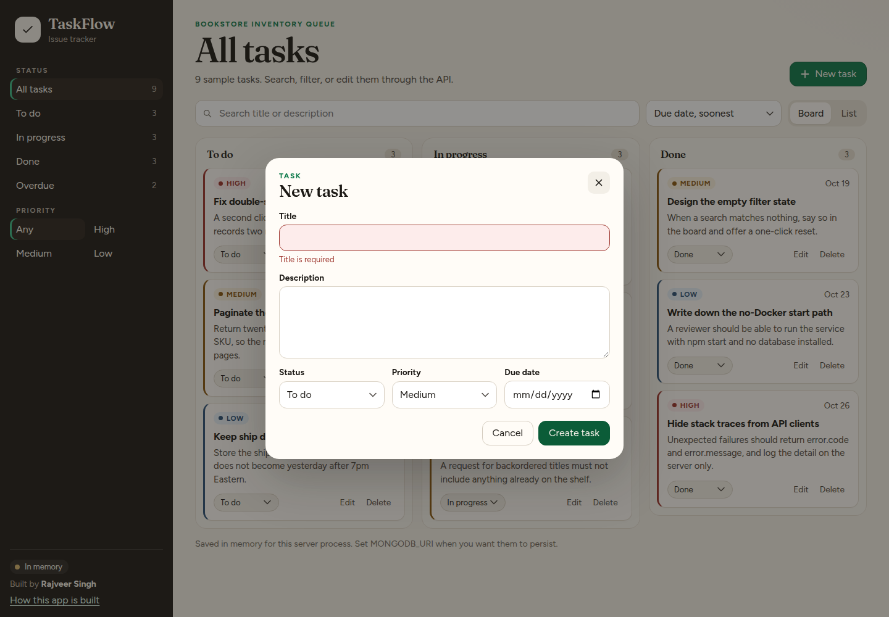
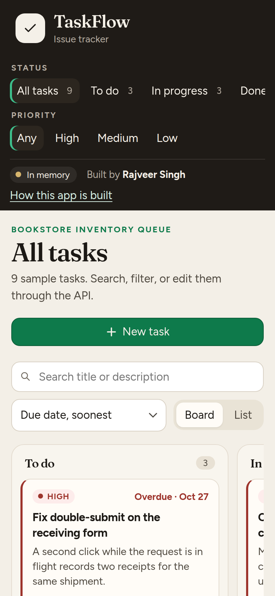

# TaskFlow

Personal issue tracker by **Rajveer Singh**, built as a junior software developer portfolio project.

Source: [https://github.com/Rajveerrsingh/Taskflow](https://github.com/Rajveerrsingh/Taskflow)

The page is a board. The API is the product. The browser never touches the database: every create, edit, move, and delete is a JSON request, and the screen reloads from the response. That split is the part I would walk through in an interview.

It runs with no database installed. Set `MONGODB_URI` when you want MongoDB instead.

## Try it

Requires Node.js 20 or newer.

```bash
git clone https://github.com/Rajveerrsingh/Taskflow.git
cd Taskflow
npm install
npm start
```

Open [http://localhost:4721](http://localhost:4721).

The first launch loads nine sample tasks into memory. They describe a bookstore inventory queue, so it is obvious this is demo data. Nothing is stored after the process stops.

```bash
npm test
```

Eighteen API tests. They use the in-memory repository, so they do not need Docker or MongoDB.

While changing code:

```bash
npm run dev
```

## Use MongoDB

```bash
docker compose up -d
cp .env.example .env
```

Uncomment `MONGODB_URI` in `.env`, then:

```bash
npm run seed
npm start
```

`npm run seed` replaces whatever is in the `taskflow` database with the sample queue. If you skip the seed and the collection is empty, startup inserts the same tasks.

If `MONGODB_URI` is set and MongoDB is down, the process exits and tells you to start Docker or unset the variable. It does not silently switch stores. A wrong database URL should be obvious.

`.env` is gitignored. The example file has no password and no real host beyond localhost.

## What the page does

- Filter by status, overdue, and priority. Counts stay global while the list is filtered.
- Search title and description. A `.` is a period, not a regular expression.
- Switch between a board and a list. The choice sticks in `localStorage`.
- Create, edit, move, and delete. Saving stays disabled until the request finishes, so a double click does not create two tasks.
- A blank title comes back as a field error from the API, and the form shows that message.
- Press `N` to open the new-task dialog.

The sidebar says whether this process is using memory or MongoDB.

## API

| Method | Path | What it does |
| --- | --- | --- |
| `GET` | `/api/health` | Liveness, and which store is active |
| `GET` | `/api` | Short route list |
| `GET` | `/api/tasks` | Filter, search, and sort |
| `POST` | `/api/tasks` | Create. Returns `201` |
| `GET` | `/api/tasks/:id` | One task |
| `PATCH` | `/api/tasks/:id` | Partial update |
| `DELETE` | `/api/tasks/:id` | Delete. Returns `204` |

Query parameters on the list: `status`, `priority`, `q`, `sort` (`dueDate`, `createdAt`, `priority`, `title`), `order` (`asc` or `desc`), `overdue` (`true` or `false`).

A task looks like this:

```json
{
  "id": "6f1c0d4e-3a1b-4d2e-9c10-9b1a0e2f4c77",
  "title": "Paginate the low-stock report",
  "description": "Return twenty titles at a time, sorted by SKU.",
  "status": "todo",
  "priority": "medium",
  "dueDate": "2026-11-04",
  "createdAt": "2026-10-29T12:00:00.000Z",
  "updatedAt": "2026-10-29T12:00:00.000Z"
}
```

`dueDate` is `YYYY-MM-DD` or `null`. It is not a timestamp, so a task due today does not become overdue at 7pm Eastern.

Errors share one shape. Unexpected failures do not include a stack trace.

```json
{
  "error": {
    "code": "VALIDATION_ERROR",
    "message": "Some fields need attention.",
    "details": [{ "field": "title", "message": "Title is required" }]
  }
}
```

Codes you will see: `VALIDATION_ERROR` (400), `INVALID_JSON` (400), `NOT_FOUND` (404), `INTERNAL_ERROR` (500).

```bash
curl -s http://localhost:4721/api/health

curl -s http://localhost:4721/api/tasks?priority=high

curl -s -X POST http://localhost:4721/api/tasks \
  -H 'Content-Type: application/json' \
  -d '{"title":"","priority":"urgent"}'
```

The last call is rejected: the title is blank, and `urgent` is not a priority. Unknown fields are rejected, so a typo in the JSON comes back as a validation error.

## How the code is split

```
Browser (public/)
        |
        v
   Express app
        |
        +-- /api router
        |     controller
        |     Zod schemas
        |     TaskService     filter, sort, counts
        |     TaskRepository
        |        |-- memory    MONGODB_URI unset
        |        \-- MongoDB   src/models/Task.js
        |
        \-- error handler      one JSON shape
```

```
src/
  server.js                 listen, seed-if-empty, shutdown
  app.js                    Express wiring, testable without a port
  seed.js                   replace MongoDB data with the sample queue
  config/env.js             PORT and MONGODB_URI
  config/storage.js         pick a repository and connect
  controllers/              HTTP in, JSON out
  services/taskService.js   rules that do not care which store is behind them
  repositories/             memory and MongoDB, same methods
  models/Task.js            Mongoose schema and the status + dueDate index
  validators/taskSchemas.js request checks
  middleware/               async errors, 404, the error handler
  domain/task.js            statuses, priorities, response shape
public/                     the page: HTML, CSS, one JS module
tests/api.test.js           supertest against the memory store
```

Express 4 does not forward a rejected promise to the error handler. Controllers are wrapped so a thrown `AppError` still becomes JSON. That wrapper is `src/middleware/asyncHandler.js`.

## Decisions worth asking about

- **Two repositories, one service.** Memory and MongoDB implement the same methods. The service filters in process so those stores cannot drift. The schema already declares `{ status: 1, dueDate: 1 }` for the day that filter moves into the query.
- **Validation at the edge.** Zod runs before the service. The model still has enums and lengths, so a bug in a caller cannot write a status the board does not know.
- **Search uses `includes`, not a regex.** A search for `.` matches a period.
- **Date-only due dates.** Compared to UTC today as strings. Overdue ignores tasks that are done.
- **Undated tasks sort last** on due date, in either direction. "No date" should not jump to the top when you flip the sort.
- **No login.** This is a single-user demo. The routes live on one router, which is where a session check would go without touching each handler.
- **Task text is `textContent`.** Titles are not written as HTML.
- **JSON bodies are capped at 100kb.** Helmet sets the security headers, including a content security policy for the page.

## Where to look

| If you want to see… | Open |
| --- | --- |
| A request move through the app | `src/routes/index.js`, then the controller |
| Field errors | `src/validators/taskSchemas.js` |
| The single error shape | `src/middleware/errorHandler.js` |
| The MongoDB model | `src/models/Task.js` |
| Why `npm start` needs no database | `src/config/storage.js` |
| The tests | `tests/api.test.js` |

## Skills this is meant to show

For a junior software engineer role, including product and financial-services teams:

| Skill | Where it shows up |
| --- | --- |
| REST resource design | The tasks collection, status codes, partial update |
| Input validation | Zod schemas, including real calendar dates |
| Central error handling | One middleware, no stack traces to clients |
| Layering you can draw | Route, controller, service, repository, model |
| MongoDB modeling | Schema, enums, a compound index, Docker Compose |
| Configuration without secrets | `.env.example`, gitignored `.env` |
| A runnable default | In-memory store so a reviewer is not blocked on setup |
| Tests around the HTTP boundary | `npm test` |
| A UI that only uses the API | `public/js/app.js` |
| Basic accessibility | Labels, dialog focus, keyboard shortcut, visible focus |

What I would add next, in order: a session check on the router, pagination, and pushing filters into the MongoDB query once this is no longer a personal queue.

## Screenshots

Board, with the seeded queue. Overdue work stays in its status column and is also counted on the left.



An empty title is saved only if the API accepts it. The message under the field is `error.details` from the `400`.



The same board on a narrow screen. Status filters scroll, and the columns snap sideways.



## Scripts

| Command | What it does |
| --- | --- |
| `npm start` | API and page on port `4721`, or `PORT` |
| `npm run dev` | Same, restarting when files change |
| `npm test` | API tests |
| `npm run seed` | Replace MongoDB tasks with the sample queue |
| `docker compose up -d` | Local MongoDB 7 on port `27017` |

## Troubleshooting

- **Port in use.** Start with `PORT=4722 npm start`.
- **Tasks vanished after a restart.** The sidebar said "In memory". Set `MONGODB_URI` to keep them.
- **`Could not connect to MongoDB`.** Run `docker compose up -d`, or comment out `MONGODB_URI`.
- **`npm run seed` does nothing useful.** It only writes to MongoDB. With no URI it explains that and exits.

## License

MIT. See [LICENSE](LICENSE).
